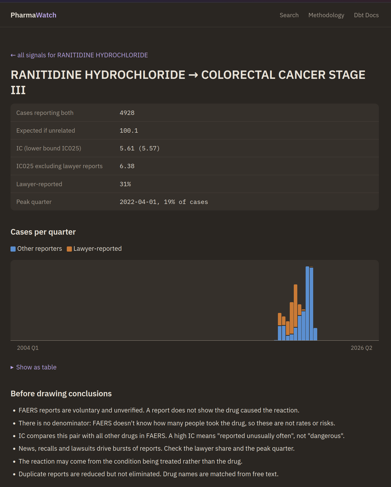
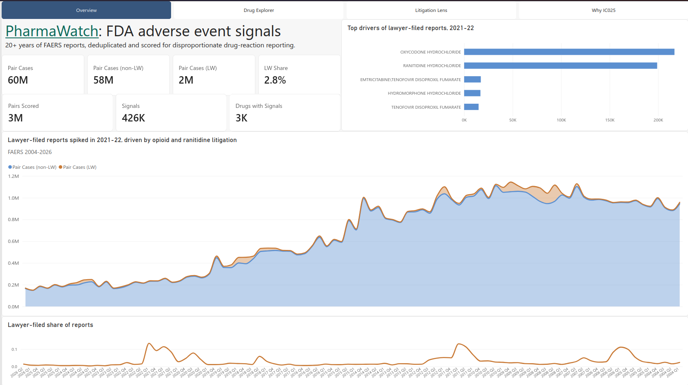
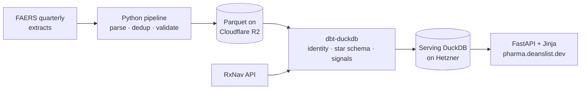

<div align="center">

# PharmaWatch

**Drug safety signals from every FDA adverse event report since 2004.**

[**Live site**](https://pharma.deanslist.dev) · [Methodology](https://pharma.deanslist.dev/methodology) · [dbt docs](https://pharma.deanslist.dev/static/dbt-docs.html) · [Power BI report](https://app.powerbi.com/view?r=eyJrIjoiMTNhZjAwOGItY2VjNC00NDExLTg3ODktOGZiYjE2ZDNiNGRmIiwidCI6ImY4NjQ4NjU0LWY1MWEtNDBjZC1hMGEwLTc5NzFiMWFhNmVkMiJ9)


</div>

Search a drug, see which adverse reactions are reported unusually often for it, and open
any drug–reaction pair for its counts, a quarterly reporting chart, and the caveats that
come with FAERS data. Built for clinicians, health journalists, and analysts.

| 24.8M | 20.6M | 139,460 → 11,954 | 2.85M |
|:---:|:---:|:---:|:---:|
| raw reports | cases after dedup | drug-name spellings → drugs | drug–reaction pairs scored |

<details>
<summary><b>Screenshot: live site</b></summary>
<br>

</details>

<details>
<summary><b>Screenshot: Power BI report</b></summary>
<br>
<a href="https://app.powerbi.com/view?r=eyJrIjoiMTNhZjAwOGItY2VjNC00NDExLTg3ODktOGZiYjE2ZDNiNGRmIiwidCI6ImY4NjQ4NjU0LWY1MWEtNDBjZC1hMGEwLTc5NzFiMWFhNmVkMiJ9"></a>
<br>
Four pages over the serving layer: Overview, Drug explorer, Litigation lens, and Why IC025.
</details>

## Architecture



## The hard parts

- **20 years of schema drift.** FAERS changed file names, column layouts, and delimiters
  several times, with broken rows along the way. The pipeline maps every era to one
  schema and keeps only the latest version of each case. Every defect found is in the
  [mess log](docs/mess_log.md) (43 entries and counting).
- **One drug, 390 spellings.** Drug names are free text. Each one is resolved to its set of
  RxNorm ingredients, so brands, generics, salt forms, and typos collapse to one drug.
- **Honest ranking.** PRR and ROR blow up on small counts, so signals are ranked by IC025,
  a shrunk lower bound that rewards evidence over ratio.
- **Lawyer bursts.** Litigation floods (ranitidine, 2021) inflate counts. They're
  flagged, not dropped: each pair shows its lawyer-reported share, peak-quarter share, and
  a score recomputed without lawyer reports.

The [methodology page](https://pharma.deanslist.dev/methodology) walks through each of
these with real numbers. Design choices are recorded in [docs/decisions](docs/decisions/).

## Repo tour

| Path | What's there |
|---|---|
| [`src/faers/`](src/faers/) | Ingestion: download, parse, schema crosswalk, clean, merge, dedup, validate, load to R2 |
| [`dbt/`](dbt/) | Staging, drug identity, star schema, PRR / ROR / IC signal marts, tests |
| [`scripts/`](scripts/) | RxNav fetchers, export of serving tables |
| [`src/api/`](src/api/) | FastAPI app and Jinja templates behind the live site |
| [`docs/`](docs/) | [Architecture](docs/structure.md), [star schema](docs/star_schema.md), [decisions](docs/decisions/), [mess log](docs/mess_log.md) |

<details>
<summary><b>Running it locally</b></summary>

Requires Python 3.12+ and [uv](https://docs.astral.sh/uv/).

```bash
uv sync
cp .env.example .env                           # R2 credentials (pipeline only)
cp dbt/profiles.example.yml dbt/profiles.yml

uv run python -m faers.<stage>                 # each pipeline stage runs standalone
cd dbt && uv run dbt deps && uv run dbt build --target prod && cd ..
uv run python scripts/export_serving.py        # -> dbt/pharmawatch_serving.duckdb
cd dbt && uv run dbt docs generate --static && cd ..   # optional: dbt docs page
cp dbt/target/static_index.html src/api/static/dbt-docs.html
uv run uvicorn api.main:app                    # http://127.0.0.1:8000
```

</details>

## Limitations

FAERS reports are voluntary and unverified. A signal means "reported unusually often",
not "caused by", and FAERS has no denominator, so nothing here is a rate or a risk. Drug
matching is good but not perfect; known residual errors are listed in
[decision 013](docs/decisions/013-mvp-scope.md).

**Next (v1.1):** finish drug-name normalization, EBGM scoring, change-point detection for
reporting bursts, and plain-English questions over drug labels (RAG).

## License

[MIT](LICENSE)
