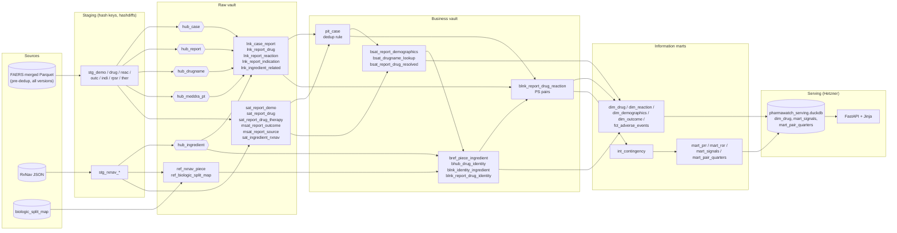
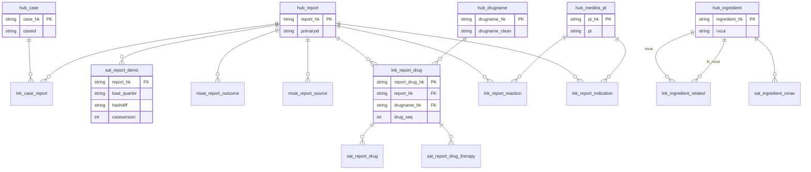

# Data Vault Implementation (hypothetical)

What PharmaWatch's dbt layers and serving layer would look like if modeled in Data
Vault 2.0 instead of staging → intermediate → star schema. This is a thought exercise,
not a decision. The current design is in `star_schema.md` and `docs/decisions/`.

The raw vault in this design loads **before** dedup: every case version FAERS ever
published lands in the vault, and `dedup.py`'s "latest version wins" rule becomes a
business rule instead of a destructive step.

## Layer mapping

| Today | Data Vault | What changes |
|---|---|---|
| `clean.py` → `merge.py` → merged Parquet | Staging (hash keys, hashdiffs, record source) | Adds `*_hk`, `hashdiff`, `load_quarter`, `record_source` columns. No business logic. |
| `dedup.py` → deduped Parquet on R2 | *(moved)* `pit_case` in the business vault | Superseded versions are kept, not dropped. |
| `models/staging/stg_*` | Raw vault: hubs, links, satellites | Same typing/casts, split by business key instead of by FAERS file. |
| `models/intermediate/int_*` | Business vault: computed satellites, business links/hubs, PIT | Same logic, but every corpus-wide count reads through `pit_case`. |
| `models/marts/*` | Information marts | Unchanged logic; inputs change. |
| `export_serving.py` → serving DuckDB | Serving | Unchanged. |

Size of what "before dedup" adds: the merged `demo` table has 24,680,706 report rows;
dedup keeps 20,586,655. About 4.1M rows (~17%) are superseded case versions that today
are dropped and in the vault would be satellite history. Child tables (drug, reac, ...)
grow by a similar share, since each version restates its full drug and reaction lists.

## Conventions

- `*_hk` = `md5(upper(trim(business_key)))`; link hash keys hash the concatenated hub
  keys (plus dependent child key where there is one).
- Every row carries `load_quarter` (the FAERS extract it arrived in, e.g. `2019Q3`)
  and `record_source` (e.g. `faers/2019Q3/DRUG19Q3.txt`, `rxnav/related`).
- Satellites carry `hashdiff` over their descriptive columns; a new row is inserted
  only when the hashdiff changes. Nothing is updated or deleted, which matches hard
  rule 1 (landed data is read-only) at the warehouse layer too.
- Prefixes: `hub_`, `lnk_`, `sat_`, `msat_` (multi-active satellite), `ref_`, and
  `b` for business vault objects (`bhub_`, `blnk_`, `bsat_`), `pit_` for PIT tables.

## Raw vault

### Hubs

| Hub | Business key | Why it's a hub |
|---|---|---|
| `hub_case` | `caseid` | The patient event. Stable across versions. |
| `hub_report` | `primaryid` | One version of a case. FAERS child rows key on this, so it has to be a key, not an attribute. |
| `hub_drugname` | `drugname_clean` | The reported product string. `int_drugname_lookup` is keyed on it. |
| `hub_meddra_pt` | MedDRA preferred term | Shared by reactions **and** indications. One hub, two links. |
| `hub_ingredient` | `rxcui` | RxNorm concept. The real drug identity anchor. |

### Links

| Link | Hubs | Dependent child key | Source |
|---|---|---|---|
| `lnk_case_report` | case, report | | demo |
| `lnk_report_drug` | report, drugname | `drug_seq` | drug |
| `lnk_report_reaction` | report, meddra_pt | | reac |
| `lnk_report_indication` | report, meddra_pt | `indi_drug_seq` | indi |
| `lnk_ingredient_related` | ingredient (rxcui), ingredient (in_rxcui) | | RxNav related |

`drug_seq` is a dependent child key: the same report can list the same drugname twice
(two doses, two lots), and those are different rows.

### Satellites

| Satellite | Parent | Columns (from today's staging) |
|---|---|---|
| `sat_report_demo` | `hub_report` | caseversion, i_f_code, event/fda/init_fda/death dates, age, age_cod, age_grp, sex, wt, wt_cod, rept_cod, occp_cod, reporter/occr country, mfr_sndr |
| `sat_report_drug` | `lnk_report_drug` | role_cod, drugname (raw), prod_ai, route, dose_amt/unit/form/freq, nda_num, lot_number, dechal, rechal, exp_dt |
| `sat_report_drug_therapy` | `lnk_report_drug` | start_dt, end_dt, dur, dur_cod (ther, joined on `drug_seq`) |
| `msat_report_outcome` | `hub_report` | outcome_code (many per report: death + hospitalization) |
| `msat_report_source` | `hub_report` | report_source_code (rpsr) |
| `sat_ingredient_rxnav` | `hub_ingredient` | rxcui_name, tty |

### Reference tables

| Table | Key | Notes |
|---|---|---|
| `ref_rxnav_piece` | `piece`, `rxnorm_version` | `stg_rxnav_rxcui`. Versioned, so the 008 salt-list refetch adds rows instead of replacing them. |
| `ref_biologic_split_map` | `piece` | The seed, unchanged. |

### Where versions live

Today a case is one `primaryid` after dedup. In the vault:

```
hub_case  caseid=1001
  └─ lnk_case_report ── hub_report primaryid=100101  (caseversion 1, loaded 2019Q3)
  └─ lnk_case_report ── hub_report primaryid=100102  (caseversion 2, loaded 2020Q1)
                           ├─ lnk_report_drug (drug_seq 1, 2, 3)
                           ├─ lnk_report_reaction (3 PTs; v1 had 2)
                           └─ msat_report_outcome (HO, DE)
```

A follow-up that drops a reaction doesn't delete anything. The v1 link row stays; it
just isn't reachable through the current report.

## Business vault

| Object | Replaces | Grain / content |
|---|---|---|
| `pit_case` | `dedup.py` | One row per (case, snapshot_quarter): the winning `report_hk` as of that quarter. Winner rule is `dedup.py`'s: max caseversion, then most child rows, then most non-null demo fields, then lowest primaryid. |
| `bsat_report_demographics` | `int_case_demographics` | On `hub_report`: age_years, age_group, sex label, is_lw. |
| `bsat_drugname_lookup` | `int_drugname_lookup` | On `hub_drugname`: band, modal_ai. Computed over current reports only (via `pit_case`). |
| `bsat_report_drug_resolved` | `int_drug_resolved` | On `lnk_report_drug`: prod_ai_resolved, prod_ai_source. |
| `bref_piece_ingredient` | `int_piece_ingredients` | piece → identity, status. Reads `ref_rxnav_piece` at a pinned `rxnorm_version`. |
| `bhub_drug_identity` | `int_prod_ai_identity` | Business key = `identity_key` (sorted RxNorm ingredient set). A computed key, so it lives here, not in the raw vault. |
| `blnk_identity_ingredient` | `int_prod_ai_identity` | identity ↔ `hub_ingredient`, one row per ingredient in the set. |
| `blnk_report_drug_identity` | `int_prod_ai_identity` join | `lnk_report_drug` → `bhub_drug_identity`. This is where Vicodin, Norco and "HYDROCODONE/ACETAMINOPHEN" collapse to one drug; it does the job of a same-as link. |
| `blnk_report_drug_reaction` | `int_drug_reaction_pairs` | PS drug identity × reaction per current report, with is_lw and report_quarter. |

The rule that changes most: **every business-vault model that counts across the corpus
must filter through `pit_case`.** `int_drugname_lookup`'s modal_ai, the prod_ai
frequencies behind `dim_drug`'s label, and the a/b/c/d counts all assume one report per
case. Reading the raw vault directly would count superseded versions and inflate every
number by roughly the 17% above.

## Information marts

Same models as today, now reading the business vault:

| Mart | Reads |
|---|---|
| `dim_drug` | `bhub_drug_identity`, `blnk_identity_ingredient`, `bsat_report_drug_resolved` |
| `dim_reaction` | `hub_meddra_pt` (filtered to reactions) |
| `dim_demographics` | `bsat_report_demographics` |
| `dim_outcome` | `msat_report_outcome` |
| `fct_adverse_events` | `blnk_report_drug_reaction` + `pit_case` + outcome flags |
| `int_contingency` | `blnk_report_drug_reaction` (moves into the mart layer as a mart-internal model) |
| `mart_prr`, `mart_ror`, `mart_signals`, `mart_pair_quarters` | `int_contingency`, unchanged |

Because `pit_case` carries a `snapshot_quarter`, the marts can also be built **as of** a
past quarter: "what did the ranitidine signal look like in 2020Q4, before the
litigation flood?" Today that question needs a re-run of dedup on a subset of quarters.

## Serving layer

Unchanged. `export_serving.py` copies `dim_drug`, `mart_signals` and
`mart_pair_quarters` into `pharmawatch_serving.duckdb`, and the FastAPI app never sees
a hub or satellite. The vault is a warehouse-side choice; the serving contract is the
three tables.

## Diagram: layers



## Diagram: raw vault



## Trade-offs

What the vault buys:

- **Version history.** ~4.1M superseded case versions kept instead of dropped. Follow-up
  changes (a reaction added, an outcome upgraded to death) become queryable.
- **As-of rebuilds.** `pit_case` by snapshot quarter lets signals be recomputed as they
  stood at any past quarter.
- **RxNorm history.** `ref_rxnav_piece` keyed on `rxnorm_version` means the 008 refetch
  and backtests compare versions side by side instead of overwriting `data/json/rxnav/`
  outputs.
- **New sources slot in.** The openFDA API feed, and post-MVP drug labels for RAG
  (keyed on RxCUI → `hub_ingredient`), attach as new satellites and links without
  touching existing models.
- **Auditability.** Every row traces to a `record_source` file and `load_quarter`.

What it costs:

- **Table count.** 10 staging + 7 intermediate today becomes ~5 hubs, 5 links, 6
  satellites, 2 refs and ~9 business-vault objects: roughly 27 models before the marts.
- **Joins.** Getting a drug–reaction pair means hub → link → satellite → PIT on every
  path. In DuckDB on a single file, with 75M drug rows, the hash joins are the
  expensive part (see the temp-table vs CTE lesson from dedup).
- **Hash-key overhead.** md5 strings on every row of the largest tables, where today
  `primaryid` and `caseid` are already usable keys.
- **The pit_case trap.** Every corpus-wide count must go through it; forgetting once
  silently inflates PRR/ROR. Today's design makes that mistake impossible because the
  superseded rows don't exist.
- **One developer.** Data Vault pays off with many sources, many teams and audit
  requirements. PharmaWatch has one source family, one author and no auditor.

## Verdict

Not worth it for the MVP. The star schema over deduped data answers every question the
site asks, and the vault's main win (version history) isn't something any page shows.

It would start paying off if:

1. Signals need to be shown **as of** a past quarter (e.g. a "how this signal evolved"
   view built on real case-version history, not just `mart_pair_quarters`).
2. Label data, openFDA API data or a second adverse-event source (VAERS, EudraVigilance)
   gets joined in, and integrating sources becomes the main work.
3. RxNorm version churn makes the 008 refetch/backtest work a recurring job rather
   than a one-off.

A cheaper middle step for (1) or (3) without a full vault: keep the pre-dedup merged
Parquet on R2 alongside the deduped output, and version the RxNav pulls by
`rxnorm_version`. That gets most of the history for a fraction of the models.
